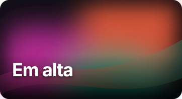
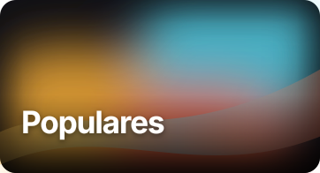

# Kazuji · Nuvio Collections

Capas, emblemas e referências de fontes para as coleções do Nuvio. O repositório é público e os arquivos podem ser usados diretamente por URL do GitHub Raw.

## Diretores

38 diretores com portrait colorido, portrait P&B e landscape transparente em resolução nativa.
Veja a [documentação das artes e integração](docs/diretores-artwork.md), o [manifesto com fontes e créditos](assets/covers/diretores/revisao-2026-10-17/manifest.json) e o [mapeamento dos campos no Nuvio](collections/diretores-artwork.json).

## Estúdios de produção

13 capas em Full HD/4K, 13 fundos em 4K e seis GIFs de foco (A24, Disney, DreamWorks, Pixar, Cartoon Network e Studio Ghibli), hospedados neste repositório. A Apple usa a imagem original 4K escolhida no AVID.
Importe [a coleção com animações](https://raw.githubusercontent.com/Kazuji-Media/kazuji-nuvio-colletions/feat/ptbr-collections-artwork/collections/estudios-producao.json) ou [a versão estática](https://raw.githubusercontent.com/Kazuji-Media/kazuji-nuvio-colletions/feat/ptbr-collections-artwork/collections/estudios-producao-estatico.json).
Veja [fontes, resoluções e integração](docs/estudios-artwork.md) e o [manifesto das artes](assets/covers/estudios/revisao-2026-10-18/manifest.json).
Os GIFs preservam sua resolução nativa, inferior a HD. Os JSONs preservam as 25 fontes originais e acrescentam duas fontes do Studio Ghibli; para manter edições posteriores, aplique o mapeamento a uma exportação atual com o script documentado.

## Capas

As versões abaixo usam texto em português do Brasil e gradientes animados em SVG. São novas variações vetoriais inspiradas nas capas da comunidade; não alteram nem redistribuem os GIFs de terceiros.

| Uso | Arquivo |
|---|---|
| Recomendados | [recomendados.svg](https://raw.githubusercontent.com/Kazuji-Media/kazuji-nuvio-colletions/feat/ptbr-collections-artwork/assets/covers/recomendados.svg) |
| Em alta | [em-alta.svg](https://raw.githubusercontent.com/Kazuji-Media/kazuji-nuvio-colletions/feat/ptbr-collections-artwork/assets/covers/em-alta.svg) |
| Populares | [populares.svg](https://raw.githubusercontent.com/Kazuji-Media/kazuji-nuvio-colletions/feat/ptbr-collections-artwork/assets/covers/populares.svg) |
| Recomendações | [recomendacoes.svg](https://raw.githubusercontent.com/Kazuji-Media/kazuji-nuvio-colletions/feat/ptbr-collections-artwork/assets/covers/recomendacoes.svg) |
| Pasta Apple TV+ | [apple-tv-plus.svg](https://raw.githubusercontent.com/Kazuji-Media/kazuji-nuvio-colletions/feat/ptbr-collections-artwork/assets/covers/apple-tv-plus.svg) |

As capas de **Descobrir** usam o mesmo degradê animado, cada uma com um título próprio em pt-BR:

| Pasta | Capa |
|---|---|
| Filmes recentes | [filmes-recentes.svg](https://raw.githubusercontent.com/Kazuji-Media/kazuji-nuvio-colletions/feat/ptbr-collections-artwork/assets/covers/filmes-recentes.svg) |
| Séries recentes | [series-recentes.svg](https://raw.githubusercontent.com/Kazuji-Media/kazuji-nuvio-colletions/feat/ptbr-collections-artwork/assets/covers/series-recentes.svg) |
| Filmes em alta | [filmes-em-alta.svg](https://raw.githubusercontent.com/Kazuji-Media/kazuji-nuvio-colletions/feat/ptbr-collections-artwork/assets/covers/filmes-em-alta.svg) |
| Séries em alta | [series-em-alta.svg](https://raw.githubusercontent.com/Kazuji-Media/kazuji-nuvio-colletions/feat/ptbr-collections-artwork/assets/covers/series-em-alta.svg) |
| Séries aclamadas | [series-aclamadas.svg](https://raw.githubusercontent.com/Kazuji-Media/kazuji-nuvio-colletions/feat/ptbr-collections-artwork/assets/covers/series-aclamadas.svg) |
| Filmes aclamados | [filmes-aclamados.svg](https://raw.githubusercontent.com/Kazuji-Media/kazuji-nuvio-colletions/feat/ptbr-collections-artwork/assets/covers/filmes-aclamados.svg) |

Prévia:

Referências que você selecionou no catálogo Nuvio:
- [Recommended (GIF)](https://s13.gifyu.com/images/bqg1K.gif)
- [Trending (GIF)](https://media0.giphy.com/media/v1.Y2lkPTc5MGI3NjExbTYzenpuNGlla3g0enVvejliN256anEwMjIxd2oyN3gxcmRuZGsyYSZlcD12MV9pbnRlcm5hbF9naWZfYnlfaWQmY3Q9Zw/dEqOn4HBV7EKhNRxxu/giphy.gif)
- [Popular (GIF, alternativa parecida)](https://media0.giphy.com/media/v1.Y2lkPTc5MGI3NjExMWR1bGV3MzVhcmFibWFsM2xxOXJndmdnZWRiejd6aWN5bjVjNzE3ZiZlcD12MV9pbnRlcm5hbF9naWZfYnlfaWQmY3Q9Zw/SIsUa2Bmgh5vKACu7v/giphy.gif)
- [Ver outras capas landscape em GIF, ordenadas por popularidade](https://nuvio.tv/covers?format=gif&filter=landscape&sort=popular)

## Emblemas Fusion

A configuração completa migrou para [badges.json](https://raw.githubusercontent.com/Kazuji-Media/kazuji-nuvio-colletions/main/badges.json) e a base para [badges.base.json](https://raw.githubusercontent.com/Kazuji-Media/kazuji-nuvio-colletions/main/badges.base.json). Os SVGs mantidos pelo Kazuji ficam em [assets/badges/fusion](https://raw.githubusercontent.com/Kazuji-Media/kazuji-nuvio-colletions/main/assets/badges/fusion/); a licença de fonte foi copiada junto com eles.

Os nomes dos grupos foram localizados para pt-BR e o texto incorreto `sss` do emblema 4K foi corrigido. Os rótulos técnicos permanecem como padrões conhecidos. Imagens originalmente mantidas por outros autores continuam apontando para as fontes originais.

Origem: [Kazuji Nuvio Plugin](https://github.com/Kazuji-Media/kazuji-nuvio-plugin). No Nuvio, reimporte o pacote pela URL de [badges.json](https://raw.githubusercontent.com/Kazuji-Media/kazuji-nuvio-colletions/main/badges.json) para usar as URLs novas.

## Fontes TMDB

Veja [docs/fontes-tmdb.md](docs/fontes-tmdb.md) para as opções de descoberta, listas, estúdios, redes, franquias, créditos e cerimônias do Oscar.

## Capas de gêneros e décadas

Os dez gêneros com referência upstream também têm uma versão `-focus.png` com as
silhuetas originais e título em pt-BR. As capas normais atuais são preservadas.
Veja os [pares normal/foco e a integração](docs/capas-generos.md) e o
[mapeamento dos campos de foco](collections/generos-artwork.json).

As capas dos gêneros preservam a arte preto e branco das imagens usadas na coleção complementar; os rótulos foram localizados para pt-BR. As imagens originais foram copiadas sem alteração para [assets/covers/generos/originais](https://github.com/Kazuji-Media/kazuji-nuvio-colletions/tree/feat/ptbr-collections-artwork/assets/covers/generos/originais). A capa de Suspense usa uma composição original com rosto e mariposa, inspirada na referência enviada, no mesmo estilo gráfico.

| Gênero | Capa pt-BR | Arte original |
|---|---|---|
| Ação | [acao.png](https://raw.githubusercontent.com/Kazuji-Media/kazuji-nuvio-colletions/feat/ptbr-collections-artwork/assets/covers/generos/acao.png) | [acao-original.png](https://raw.githubusercontent.com/Kazuji-Media/kazuji-nuvio-colletions/feat/ptbr-collections-artwork/assets/covers/generos/originais/acao-original.png) |
| Animação | [animacao.png](https://raw.githubusercontent.com/Kazuji-Media/kazuji-nuvio-colletions/feat/ptbr-collections-artwork/assets/covers/generos/animacao.png) | [animacao-original.png](https://raw.githubusercontent.com/Kazuji-Media/kazuji-nuvio-colletions/feat/ptbr-collections-artwork/assets/covers/generos/originais/animacao-original.png) |
| Comédia | [comedia.png](https://raw.githubusercontent.com/Kazuji-Media/kazuji-nuvio-colletions/feat/ptbr-collections-artwork/assets/covers/generos/comedia.png) | [comedia-original.png](https://raw.githubusercontent.com/Kazuji-Media/kazuji-nuvio-colletions/feat/ptbr-collections-artwork/assets/covers/generos/originais/comedia-original.png) |
| Crime | [crime.png](https://raw.githubusercontent.com/Kazuji-Media/kazuji-nuvio-colletions/feat/ptbr-collections-artwork/assets/covers/generos/crime.png) | [crime-original.png](https://raw.githubusercontent.com/Kazuji-Media/kazuji-nuvio-colletions/feat/ptbr-collections-artwork/assets/covers/generos/originais/crime-original.png) |
| Documentário | [documentario.png](https://raw.githubusercontent.com/Kazuji-Media/kazuji-nuvio-colletions/feat/ptbr-collections-artwork/assets/covers/generos/documentario.png) | [documentario-original.png](https://raw.githubusercontent.com/Kazuji-Media/kazuji-nuvio-colletions/feat/ptbr-collections-artwork/assets/covers/generos/originais/documentario-original.png) |
| Fantasia | [fantasia.png](https://raw.githubusercontent.com/Kazuji-Media/kazuji-nuvio-colletions/feat/ptbr-collections-artwork/assets/covers/generos/fantasia.png) | [fantasia-original.png](https://raw.githubusercontent.com/Kazuji-Media/kazuji-nuvio-colletions/feat/ptbr-collections-artwork/assets/covers/generos/originais/fantasia-original.png) |
| Ficção científica | [ficcao-cientifica.png](https://raw.githubusercontent.com/Kazuji-Media/kazuji-nuvio-colletions/feat/ptbr-collections-artwork/assets/covers/generos/ficcao-cientifica.png) | [ficcao-cientifica-original.png](https://raw.githubusercontent.com/Kazuji-Media/kazuji-nuvio-colletions/feat/ptbr-collections-artwork/assets/covers/generos/originais/ficcao-cientifica-original.png) |
| Faroeste | [faroeste.png](https://raw.githubusercontent.com/Kazuji-Media/kazuji-nuvio-colletions/feat/ptbr-collections-artwork/assets/covers/generos/faroeste.png) | [faroeste-original.png](https://raw.githubusercontent.com/Kazuji-Media/kazuji-nuvio-colletions/feat/ptbr-collections-artwork/assets/covers/generos/originais/faroeste-original.png) |
| História | [historia.png](https://raw.githubusercontent.com/Kazuji-Media/kazuji-nuvio-colletions/feat/ptbr-collections-artwork/assets/covers/generos/historia.png) | [historia-original.png](https://raw.githubusercontent.com/Kazuji-Media/kazuji-nuvio-colletions/feat/ptbr-collections-artwork/assets/covers/generos/originais/historia-original.png) |
| Suspense | [suspense.png](https://raw.githubusercontent.com/Kazuji-Media/kazuji-nuvio-colletions/feat/ptbr-collections-artwork/assets/covers/generos/suspense.png) | Criação nova |
| Terror | [terror.png](https://raw.githubusercontent.com/Kazuji-Media/kazuji-nuvio-colletions/feat/ptbr-collections-artwork/assets/covers/generos/terror.png) | [terror-original.png](https://raw.githubusercontent.com/Kazuji-Media/kazuji-nuvio-colletions/feat/ptbr-collections-artwork/assets/covers/generos/originais/terror-original.png) |

As capas de décadas substituem imagens hospedadas no Nuvio que não carregavam:

| Década | Arquivo |
|---|---|
| Anos 1990 | [anos-1990.svg](https://raw.githubusercontent.com/Kazuji-Media/kazuji-nuvio-colletions/feat/ptbr-collections-artwork/assets/covers/decadas/anos-1990.svg) |
| Anos 2000 | [anos-2000.svg](https://raw.githubusercontent.com/Kazuji-Media/kazuji-nuvio-colletions/feat/ptbr-collections-artwork/assets/covers/decadas/anos-2000.svg) |
| Anos 2010 | [anos-2010.svg](https://raw.githubusercontent.com/Kazuji-Media/kazuji-nuvio-colletions/feat/ptbr-collections-artwork/assets/covers/decadas/anos-2010.svg) |
| Anos 2020 | [anos-2020.svg](https://raw.githubusercontent.com/Kazuji-Media/kazuji-nuvio-colletions/feat/ptbr-collections-artwork/assets/covers/decadas/anos-2020.svg) |

As artes-base de gêneros foram obtidas de [tolbertsol/nuvio](https://github.com/tolbertsol/nuvio/tree/main/images/genres/silhouettes), preservadas sem alteração na pasta `originais/` e acompanhadas de versões localizadas. Crime já estava escrito da mesma forma em português. Veja [docs/capas-generos.md](docs/capas-generos.md) para a correspondência das fontes.

## GIFs de streamings

Apple TV, HBO Max, Netflix, Disney+, Prime Video, Hulu e Paramount+ agora têm GIFs de foco em **720p**, com capas estáticas em **1080p**, baseados nas identidades documentadas no AVID.
Veja [seleção, créditos e integração](docs/streamings-artwork.md), o [manifesto das artes](assets/covers/streamings/revisao-2026-10-18/manifest.json) e a [coleção pronta para importar](https://raw.githubusercontent.com/Kazuji-Media/kazuji-nuvio-colletions/feat/ptbr-collections-artwork/collections/streamings.json).
As 15 fontes de catálogo foram preservadas. A Apple usa a abertura de vidro de 2025; o HBO Max usa uma captura limpa da identidade roxa de 2020. Os GIFs anteriores de Netflix e Paramount+ continuam nos caminhos antigos.
